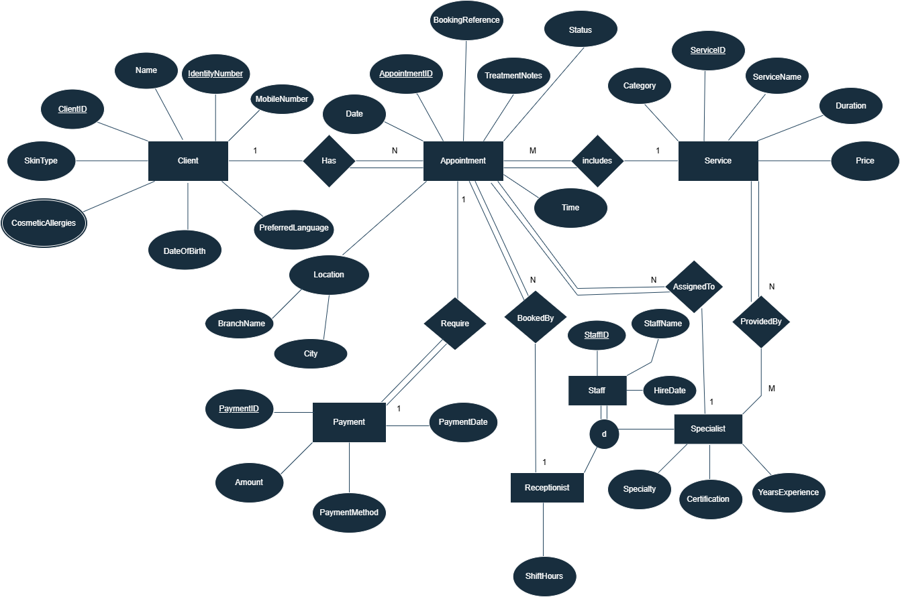

# Dora Clinic Database

An Oracle SQL course project for Database Fundamentals (IS 220) at Princess Nourah University. The database models a cosmetic clinic's clients, allergies, services, staff, appointments, and payments.

## Run in Oracle SQL Developer

Use the same development connection and worksheet for all three scripts. Run them in order with **Run Script (F5)**.

| File | Purpose |
| --- | --- |
| [01-DDL.sql](01-DDL.sql) | Creates the tables and constraints. The opening `DROP TABLE` statements are for rebuilding the project. On a fresh schema, run only the section beginning at the first `CREATE TABLE`. |
| [02-DML.sql](02-DML.sql) | Inserts the project records. |
| [03-Queries.sql](03-Queries.sql) | Runs the demonstration queries, including an update and a delete, and ends with a commit. |

## Conceptual ERD

